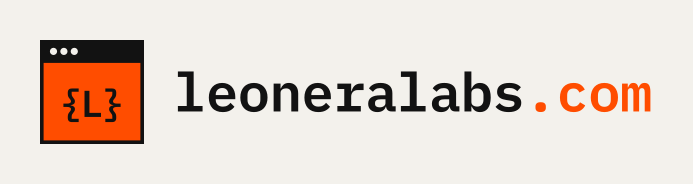

# leoneralabs.com

Sitio personal de **Leonardo Ramirez Rangel**, desarrollador de software. Tiene dos objetivos:
mostrar las apps que he desarrollado y presentarme como desarrollador ante empresas que buscan
talento de ingeniería.

Este repositorio trae **cuatro propuestas de diseño** con el mismo contenido. Cada una tiene su
propio logo. Abre `index.html` (la página selectora) para compararlas y elegir una.

| | Opción | Estilo | Tipografía | ¿Monoespaciada? |
|---|---|---|---|---|
|  | [1 · Terminal](opcion-1-terminal/) | Oscuro, inspirado en la línea de comandos | JetBrains Mono | **Sí**: en el logo y en todo el sitio |
|  | [2 · Laboratorio](opcion-2-laboratorio/) | Papel cuadriculado y estética de editor de código: proyectos en ventanas y el stack como archivos | IBM Plex Mono + IBM Plex Sans | **Sí**: en el logo, las etiquetas, las fichas y el stack |
|  | [3 · Estudio de producto](opcion-3-estudio/) | Moderno y colorido, con maquetas de teléfono | Bricolage Grotesque + Inter | No |
|  | [4 · Editorial](opcion-4-editorial/) | Cálido, como una revista: casos de estudio, índice y capitulares | Fraunces + Instrument Sans | No |

Los cuatro sitios son HTML y CSS puros: no hay frameworks ni pasos de compilación, y
funcionan bien en celular.

> [!IMPORTANT]
> Las opciones 1 y 2 ya muestran los 12 proyectos reales publicados en
> <https://leonardoramirezr.github.io/home/>, con su stack. Las apps de las opciones 3 y 4
> (Melena, Rugido, Manada y Garra) siguen siendo **ejemplos** para mostrar el diseño (ver
> [Personalizar el contenido](#personalizar-el-contenido)).

## Estructura

```
.
├── index.html                 Página selectora para comparar las 4 opciones
├── previews/                  Capturas que usa la página selectora
├── opcion-1-terminal/         Cada opción es un sitio completo e independiente:
│   ├── index.html               la página
│   ├── styles.css               los estilos
│   ├── logo.svg                 el logo (con las letras convertidas a trazos)
│   └── favicon.svg              el ícono de la pestaña
├── opcion-2-laboratorio/
├── opcion-3-estudio/
├── opcion-4-editorial/
└── tools/generar_logos.py     Script que genera logo.svg y favicon.svg
```

Cada carpeta `opcion-*` usa solo rutas relativas, así que puede publicarse tal cual como la raíz
de `leoneralabs.com`.

## Ver el sitio en tu computadora

Puedes abrir cualquier `index.html` directamente en el navegador, pero los enlaces entre carpetas
funcionan mejor con un servidor local:

```bash
python3 -m http.server 8000
# o bien
npx serve .
```

Luego visita <http://localhost:8000>.

## Personalizar el contenido

En los archivos HTML, busca los comentarios `<!-- EDITA: ... -->`. Marcan lo que debes cambiar:

- **Apps**: nombre, descripción, plataforma, tecnologías, año y enlaces (los `href="#"`).
- **Correo**: `hola@leoneralabs.com`. Puedes recibirlo en tu Gmail con Email Routing de
  Cloudflare (ver [Extras](#extras-recomendados)).
- **LinkedIn**: reemplaza `TU-USUARIO` por tu usuario.
- **Stack y números** (apps publicadas, tecnologías, etc.).
- **Foto** (opción 3): sustituye el bloque con las iniciales «LR» por una imagen.

Un CV en PDF ayuda mucho cuando te buscan reclutadores: guárdalo en la carpeta de tu opción
(por ejemplo `cv.pdf`) y enlázalo desde el hero o la sección de contacto.

## Logos

Cada opción tiene su `logo.svg` y su `favicon.svg`. Dentro de los sitios, el logo está hecho
con texto y CSS (por eso, en la opción 1, el cursor parpadea). Los SVG llevan las letras
convertidas a trazos, así que se ven igual en cualquier lugar: redes sociales, GitHub o una
presentación.

Para cambiar colores o tamaños, edita `tools/generar_logos.py` y vuelve a generarlos:

```bash
pip install fonttools uharfbuzz
python3 tools/generar_logos.py
```

El script descarga las fuentes de Google Fonts a `tools/.fonts/` (esa carpeta no se sube a git).
Todas las fuentes usan la licencia SIL Open Font License, que permite usarlas en logos y sitios.

## Publicar en Cloudflare

Como `leoneralabs.com` ya está registrado en Cloudflare, el DNS ya vive ahí y conectar el dominio
es casi automático. La forma recomendada es **Cloudflare Pages conectado a GitHub**: cada vez que
subas cambios a `main`, el sitio se actualiza solo. El plan gratuito alcanza de sobra.

> Los nombres de los menús del panel de Cloudflare cambian de vez en cuando. Si alguno no coincide
> exactamente, busca el más parecido.

### 1. Crear el proyecto en Cloudflare Pages

1. Entra a <https://dash.cloudflare.com> y abre **Workers & Pages**.
2. Selecciona **Create application** → **Pages** → **Connect to Git**.
3. Elige **GitHub**, autoriza a Cloudflare y selecciona el repositorio
   `leonardoramirezr/Leonera-Labs-site`. Luego da clic en **Begin setup**.
4. Configura el build:

   | Campo | Valor |
   |---|---|
   | Project name | `leoneralabs` (será tu dirección `leoneralabs.pages.dev`) |
   | Production branch | `main` |
   | Framework preset | `None` |
   | Build command | vacío (si el formulario lo pide, escribe `exit 0`) |
   | Build output directory | `/` mientras comparas las 4 opciones |

5. Da clic en **Save and Deploy**. En uno o dos minutos tendrás el sitio en
   `https://leoneralabs.pages.dev`, con la página selectora y las cuatro opciones.

Además, cada rama o pull request recibe su propia URL de vista previa, útil para revisar cambios
antes de publicarlos.

### 2. Elegir la opción final

Cuando decidas cuál te gusta (por ejemplo, la 2):

1. En tu proyecto de Pages, abre **Settings** y edita la configuración de build.
2. Cambia **Build output directory** a la carpeta elegida, por ejemplo `opcion-2-laboratorio`.
3. Guarda y vuelve a desplegar: en **Deployments**, usa **Retry deployment** en el último despliegue,
   o simplemente sube un commit nuevo.

Desde ese momento, la raíz del sitio será la opción elegida. Las otras carpetas quedan en el
repositorio por si quieres volver a ellas, pero ya no se publican.

### 3. Conectar `leoneralabs.com`

1. En tu proyecto de Pages, abre **Custom domains** → **Set up a domain**.
2. Escribe `leoneralabs.com` y da clic en **Continue**.
3. Confirma el registro DNS. Como el dominio ya está en Cloudflare, el registro `CNAME` se crea solo.
4. Espera unos minutos a que el dominio aparezca como activo y se emita el certificado HTTPS.

Si el dominio no se activa, revisa en **DNS** que no tengas registros `CAA` que impidan a
Cloudflare emitir el certificado, ni registros viejos (`A` o `CNAME`) para `leoneralabs.com`
que choquen con el nuevo.

### 4. Redirigir `www.leoneralabs.com` al dominio principal

1. Repite el paso anterior con `www.leoneralabs.com`, para que también tenga registro DNS y certificado.
2. En el panel, abre el dominio `leoneralabs.com` → **Rules** y crea una **Redirect Rule**. Si
   aparece la plantilla «Redirect from WWW to root», úsala. Si no, configúrala a mano:
   - **When incoming requests match**: *Wildcard pattern*, URL `https://www.*`
   - **Then**: URL de destino `https://${1}`, código **301**, con **Preserve query string** activado.
3. Guarda y prueba que `https://www.leoneralabs.com` te lleve a `https://leoneralabs.com`.

### Alternativa: subir los archivos sin GitHub

Si prefieres no conectar GitHub, puedes subir la carpeta directamente con Wrangler, la
herramienta de línea de comandos de Cloudflare (requiere Node.js):

```bash
npx wrangler login
npx wrangler pages project create leoneralabs
npx wrangler pages deploy opcion-2-laboratorio --project-name=leoneralabs
```

También puedes arrastrar la carpeta al panel (**Workers & Pages** → **Create application** →
**Get started** → **Drag and drop your files**). Ojo: un proyecto creado por subida directa **no se puede conectar
después a Git**; tendrías que crear otro proyecto. Por eso se recomienda el método con GitHub.

### Extras recomendados

- **Correo con tu dominio**: con **Email Routing** (en el panel, dentro de **Email**) puedes
  recibir lo que llegue a `hola@leoneralabs.com` en tu Gmail, gratis. Agrega tu Gmail como
  dirección de destino, verifícalo desde el correo que te envían y crea una regla
  `hola` → tu Gmail.
- **Analítica**: activa **Web Analytics** en el proyecto de Pages para saber cuántas visitas
  recibe tu portafolio, sin cookies.
- **Página 404**: si agregas un `404.html` a la carpeta publicada, Cloudflare lo mostrará en
  rutas que no existan. Sin él, muestra la página principal.

## Lista antes de publicar

- [ ] Elegir una opción y cambiar el **Build output directory** a su carpeta.
- [ ] Si eliges la opción 3 o 4, reemplazar las apps de ejemplo por los proyectos reales.
- [ ] Revisar el correo, el usuario de LinkedIn, el stack y los números.
- [ ] (Opcional) Agregar foto y CV.
- [ ] Conectar `leoneralabs.com` y redirigir `www`.
- [ ] Revisar el sitio en celular y en computadora.
